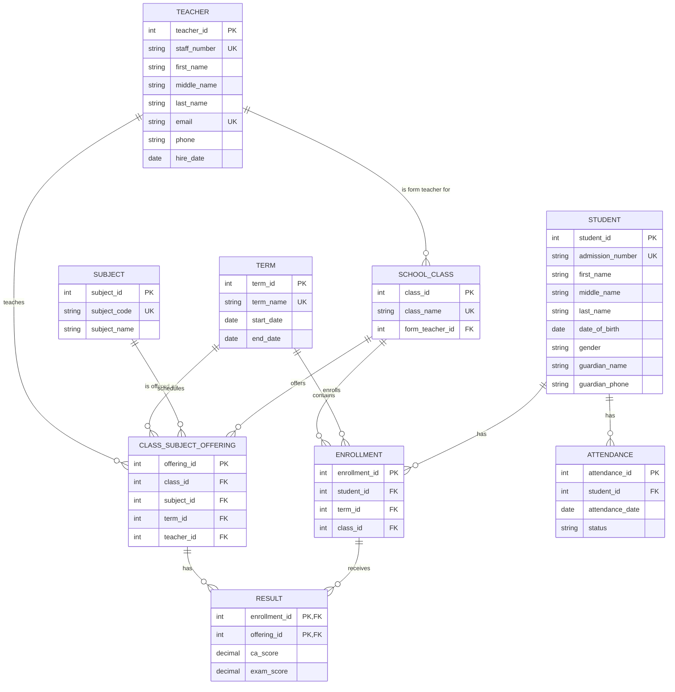

# Secondary School Database Design

## Running the SQL files

The schema targets MySQL 8.0.16+ or a MariaDB version that enforces `CHECK` constraints. From Command Prompt, run:

```bat
cd /d "C:\xampp\htdocs\swd projects\08-school-database"
C:\xampp\mysql\bin\mysql.exe -u root < schema.sql
C:\xampp\mysql\bin\mysql.exe -u root < seed.sql
```

`schema.sql` drops and recreates the school tables, so back up any data you need before re-running it. `seed.sql` is intended to run once after the schema; it adds fictional sample data for 3 classes, 8 subjects, 6 teachers, 30 students, 1 term, 240 results, and 150 attendance records.

## 1. Entities, attributes, keys, and relationships

The design treats a student's class assignment as term-specific enrollment rather than a permanent attribute of the student. This preserves class history as students advance.

| Entity | Attributes and keys | Purpose |
|---|---|---|
| **Student** | `student_id` (PK), `admission_number` (unique), `first_name`, `middle_name` (optional), `last_name`, `date_of_birth`, `gender`, `guardian_name`, `guardian_phone` | Stores each student's identity and guardian details. |
| **Teacher** | `teacher_id` (PK), `staff_number` (unique), `first_name`, `middle_name` (optional), `last_name`, `email` (unique), `phone`, `hire_date` | Stores staff details once, referenced wherever a teacher is assigned. |
| **SchoolClass** | `class_id` (PK), `class_name` (unique), `form_teacher_id` (FK → Teacher) | Represents a class such as "JSS1 A" and its form teacher. |
| **Subject** | `subject_id` (PK), `subject_code` (unique), `subject_name` | Defines a subject independently of any class or teacher. |
| **Term** | `term_id` (PK), `term_name` (unique), `start_date`, `end_date` | Represents a dated term, for example "2026/2027 First Term." |
| **Enrollment** | `enrollment_id` (PK), `student_id` (FK → Student), `term_id` (FK → Term), `class_id` (FK → SchoolClass); unique combination of `student_id` and `term_id` | Assigns a student to one class for a term and preserves class history. |
| **ClassSubjectOffering** | `offering_id` (PK), `class_id` (FK → SchoolClass), `subject_id` (FK → Subject), `term_id` (FK → Term), `teacher_id` (FK → Teacher); unique combination of `class_id`, `subject_id`, and `term_id` | Identifies a subject taken by a class in a term and the teacher assigned to it. |
| **Result** | `enrollment_id` (FK → Enrollment), `offering_id` (FK → ClassSubjectOffering), `ca_score`, `exam_score`; composite PK: (`enrollment_id`, `offering_id`) | Records one student's scores for one subject offering. |
| **Attendance** | `attendance_id` (PK), `student_id` (FK → Student), `attendance_date`, `status`; unique combination of `student_id` and `attendance_date` | Records at most one attendance status per student per day. |

CA scores should be limited to 0–40 and exam scores to 0–60. A result's total is the sum of those scores, so it can be calculated rather than stored. Attendance status should be limited to `present`, `absent`, or `late`.

### Relationships

- **Teacher 1:N SchoolClass** — each class has one form teacher. A teacher may be a form teacher for multiple classes unless the school chooses to enforce a one-class-per-teacher rule.
- **Student 1:N Enrollment** and **Term 1:N Enrollment** — students can have enrollments across terms; each enrollment assigns one student to one class for one term.
- **SchoolClass 1:N Enrollment** — a class can contain many enrolled students in a term.
- **SchoolClass M:N Subject**, resolved through **ClassSubjectOffering** — a class takes many subjects, and a subject can be taught in many classes. Each offering belongs to one term and has one assigned teacher.
- **Teacher 1:N ClassSubjectOffering** — a teacher can teach several offerings; each offering has one teacher.
- **Enrollment 1:N Result** and **ClassSubjectOffering 1:N Result** — an enrollment can receive results for several offerings, and each offering can have results for many enrollments. Together, the two references identify a student's result for an offering.
- **Student 1:N Attendance** — each attendance record belongs to one student; a student can have records for many dates.

A database-level rule should ensure that a result's enrollment and offering refer to the same term and class. This prevents a student from receiving a result for a subject offered to another class or term.

## 2. Third normal form

- **First normal form (1NF):** Each field holds one value, and repeating sets are represented as separate rows. For example, a student's subjects are not stored as a comma-separated list in the Student record; they are represented through offerings and results.
- **Second normal form (2NF):** Non-key attributes depend on the whole key. In `Result`, `ca_score` and `exam_score` depend on the combination of enrollment and offering, not just one part of that composite key.
- **Third normal form (3NF):** Non-key attributes depend on the key, the whole key, and nothing but the key. Teacher contact details live in `Teacher`, not in every class-subject offering. Student names live in `Student`, not in each attendance or result row.

### Example of a 3NF violation

If `ClassSubjectOffering` also stored `teacher_email` and `teacher_phone`, those values would depend on `teacher_id`, not directly on the offering's key. This duplicates teacher details and risks inconsistent updates. Store the contact details once in `Teacher` instead.

## 3. Mermaid ER diagram


